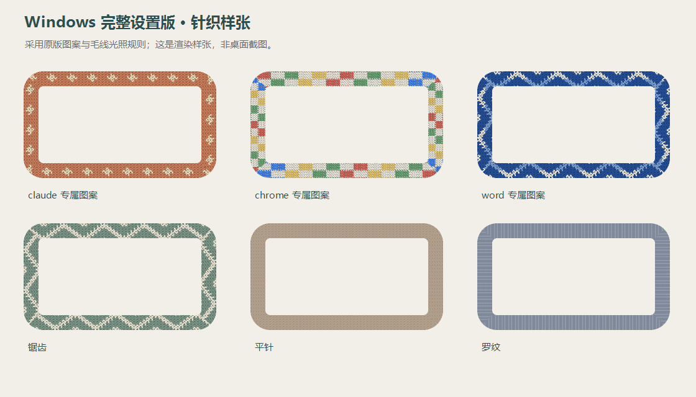
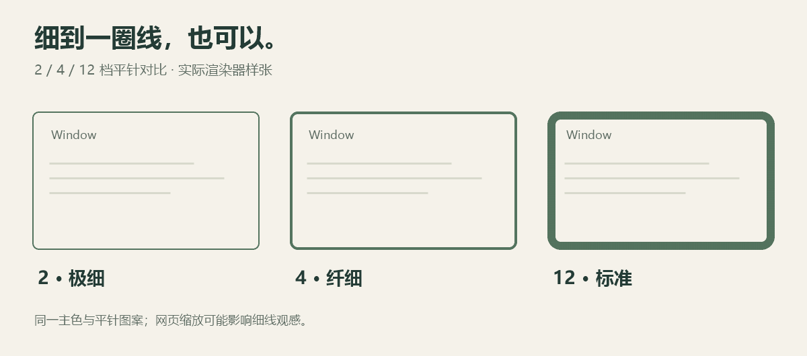

# 🧶 Window Sweaters for Windows

给 Windows 窗口穿件毛衣。

给日常使用的软件加一圈针织边框：可以是低调的细线，也可以是带花纹的毛线边。右键托盘里的毛线图标，就能调整图案、颜色和粗细。

[下载 v0.2.1](https://github.com/LY134774/window-sweaters-windows/releases/tag/v0.2.1) · [使用说明](使用说明.md) · [原 Mac 项目](https://github.com/saragordic/window-sweaters)



*上图由本项目实际使用的渲染器生成，是花纹样张，不是桌面截图。*

## v0.2.1 更新

修复搜狗输入法辅助图层导致边框突然消失的问题。升级时先退出旧版，原来的配色、图案和开关会保留。

## 你可以怎么搭

- 给不同软件选择各自的颜色与图案，也可以统一使用一种风格。
- 内置 47 个图案，支持导入自己的 PNG 重复纹样。
- 边框粗细可选 **2 / 4 / 6 / 8 / 12 / 14 / 18 / 28**；针织大小单独调整。
- 多个普通窗口都能显示边框；被前方窗口遮住的部分会隐藏。
- 边框随窗口移动、缩放，不接收鼠标点击，也不抢焦点。
- 可以暂停全部边框，或只关闭某个软件；设置在重启后保留。

## 喜欢细一点？



*同一渲染器、相同颜色与平针图案的样张对比；图片缩放会影响细线观感。*

**先试 4 · 纤细**，再按喜好换到 2 · 极细。2 档更接近细线，复杂花纹较难辨认，建议搭配平针。

## 三步开始

1. 从 [Releases](https://github.com/LY134774/window-sweaters-windows/releases/latest) 下载 `WindowSweaters-Windows-v0.2.1-x64.zip`，解压后运行 `WindowSweaters.Windows.exe`。
2. 在右下角托盘找到毛线图标。如果没看到，展开隐藏图标区。
3. **右键毛线图标**，选择边框粗细、图案，或打开“软件配色和图案”。


*上图是操作说明示意，不是程序界面截图。程序启动后没有主设置窗口，设置入口在托盘右键菜单。*

无需安装器。退出时右键毛线图标，选择“退出”。程序不设置开机启动。

## 运行环境与已知限制

目前实机验证环境是 **Windows 10 64 位、.NET Framework 4.8、100% 缩放**。发布包为 x64。

Windows 11、多屏混合缩放、管理员权限软件、远程桌面和游戏尚未完整实机验证。Windows 11 圆角已做渲染拼接检查，但这不能代替实机体验。此 Windows 版参考了原 Mac 版的图案和配色规则，两者外观与行为不保证完全一致。

程序尚未做代码签名。若 Windows 提示来源未知，请先核对发布页 SHA256，再自行决定是否运行。

## 设置与隐私

程序本身不联网，不记录窗口标题、聊天内容或键盘输入。它需要读取软件名称与窗口位置，以选择配色并绘制边框。

设置仅保存于 `%LOCALAPPDATA%\WindowSweaters`，包含开关、图案、软件配色与导入的 PNG。暂停、软件开关等设置也会保留。升级时先退出旧程序，再运行新版本；设置文件夹独立于下载目录。

## 从源码构建

使用 Windows 自带的 .NET Framework 编译工具，不依赖 NuGet 包。PowerShell 示例：

```powershell
& "$env:WINDIR\Microsoft.NET\Framework64\v4.0.30319\MSBuild.exe" .\WindowSweaters.Windows.csproj /t:Build /p:Configuration=Release
```

输出：`bin/完整设置版/WindowSweaters.Windows.exe`。

完整测试：

```powershell
& "$env:WINDIR\Microsoft.NET\Framework64\v4.0.30319\MSBuild.exe" .\tests\Tests.proj /t:Test
```

完整测试会创建测试窗口，请先退出正在使用的针织边框；测试设置使用临时目录。测试代码在 `tests/`，不随运行包分发。

## 来源与许可

本项目是 Windows 移植版。图案、配色与针织算法规则来自 [saragordic/window-sweaters v1.5.0](https://github.com/saragordic/window-sweaters/tree/v1.5.0)，原项目由 [JankyBorders](https://github.com/FelixKratz/JankyBorders) 衍生。

Windows 窗口跟踪、遮挡裁剪、托盘与设置保存由本项目实现。感谢原作者。源码按 GPL-3.0 提供，详见 [LICENSE](LICENSE)、[作者说明](NOTICE.md) 与 [上游说明](upstream/NOTICE.md)。
